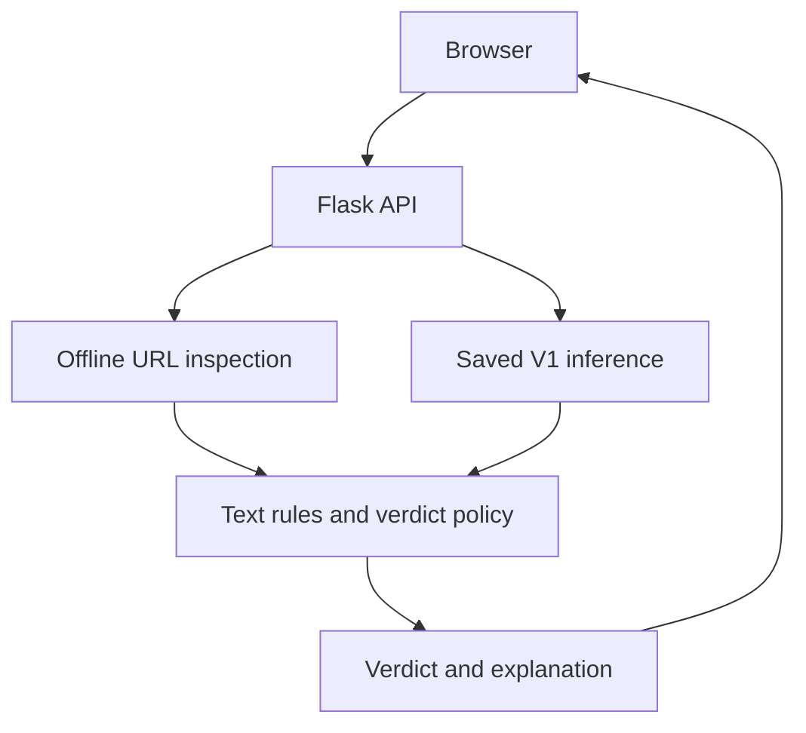
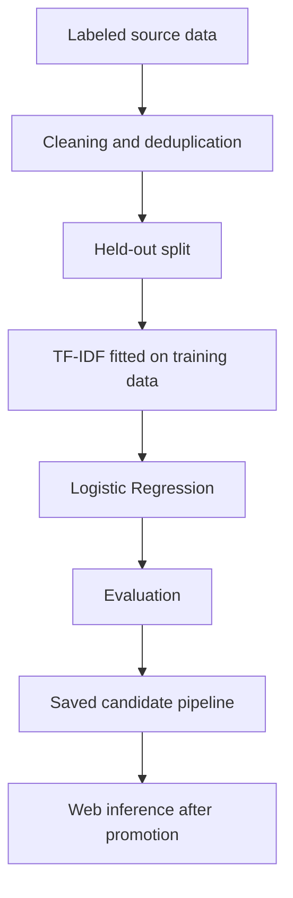

# ScamShield

Fake bank alerts, KYC threats and e-Challan payment links can look convincing. ScamShield gives Indian digital users a second look at suspicious text before they reply, pay or share information.

[Live demo](https://scamshield-himanshurajkhowa.vercel.app) · Developed by Himanshu Rajkhowa.

## Message and URL checks

- Checks pasted SMS, WhatsApp text, email text and standalone URLs.
- Sends text to a Flask API through XMLHttpRequest (AJAX), combining a locally trained spam classifier with explainable Indian scam and URL rules.
- Flags OTP/UPI PIN requests, KYC threats, payment pressure, rewards and delivery-payment requests.
- Inspects URL hostnames for impersonation, deceptive subdomains, lookalike spellings, IP addresses, unsafe schemes, shorteners and APK links.
- Returns Potential Scam, Needs a Closer Look or No Strong Scam Indicators, with reasons and safety advice.
- Includes editable fictional examples, replayable intro, saved light/dark preference, keyboard focus states and reduced-motion support. Feedback stays in the page and does not train the model.

### URL-only checks

For a standalone URL, the verdict uses URL evidence instead of the SMS model score. The parser checks the actual hostname: an official name before `@` or inside another domain does not make the destination official.

RTO/e-Challan checks compare links with `echallan.parivahan.gov.in` and `echallan.parivahan.nic.in`. Unknown domains alone are not proof of fraud. A matching reference host also cannot guarantee safety; unlisted state services need independent verification.

Submitted links are never opened, resolved, followed, executed or fetched. Reference sources: [CERT-In RTO/eChallan advisory](https://www.cert-in.org.in/s2cMainServlet?CACODE=CICA-2026-3492&pageid=PUBADV01) and [MoRTH NextGen eChallan](https://echallan.parivahan.nic.in/).

## Architecture

Python 3.12, Flask and scikit-learn serve the API and HTML/CSS/JavaScript interface. XMLHttpRequest (AJAX) sends messages without reloading. Models load lazily once per worker; inference never retrains.

### Inference Pipeline



### Training Pipeline



Files: `app.py` contains routes; `ml/` holds inference, rules and models; `training/` contains offline scripts; `templates/` and `public/static/` hold the UI; `tests/` contains regressions.

## Security

The Flask API validates JSON types and message length (3–6,000 characters), limits request bodies to 24,000 bytes, and sets CSP, `nosniff`, referrer and API `no-store` headers. Submitted text is rendered with `textContent`. URL checks parse hostnames offline; they never request the submitted destination.

The app has no message database, login or external inference service. Feedback stays in the page. Hosting-provider metadata logging is outside the app's control. There is no rate limiter or production fraud certification. Only load trusted joblib files.

## Inference cost

The active V1 pipeline is **296,455 bytes** and loads lazily once per worker. It uses bounded TF-IDF features and logistic regression, with no neural network, database or external inference API.

Measured locally with Python 3.12 on macOS ARM64:

| Measurement | Time |
|---|---:|
| First Flask test-client POST, including model load | 758.66 ms |
| 100 warm POSTs, median / p95 | 0.46 / 0.54 ms |
| 100 warm analysis calls, mean | 0.35 ms |

These measurements exclude the network and hosting platform startup. Hosted cold/warm latency has not been benchmarked. Offline and edge-device deployment remain untested possibilities.

## Testing

All **28 backend tests** and the dependency-free Node interaction suite pass. Tests cover real inference, genuine alerts, deceptive and official URLs, input validation, model caching and no-network URL inspection. Interaction tests use real Flask predictions through mocked transport; they cover first-click examples, reset, feedback, intro replay, saved themes, native reveal and reduced-motion/failure fallbacks. They do not measure browser layout.

Production browser checks passed for a genuine transaction alert, a deceptive e-Challan URL and the exact official e-Challan URL. Public health checks load V1 and exercise fake/official URL verdicts.

```sh
python -m unittest discover -s tests -v
node tests/test_ui.cjs
node --check public/static/app.js
node --check public/static/experience.js
node --check public/static/preferences.js
node --check public/static/lottie-light.min.js
```

## Models and Evaluation

Both models were trained independently using TF-IDF and logistic regression. **V1 is deployed; experimental V2 failed a smoke test and remains undeployed.** V1 was trained only on UCI SMS. India-focused signals in production come from cybersecurity rules, not validated Indian ML performance.

| Model | Training data | Train / test records | Saved size |
|---|---|---:|---:|
| V1 | UCI SMS | 4,127 / 1,032 | 296,455 bytes |
| V2 | UCI, Indian Telecom SMS, bounded Enron sample | 10,027 / 2,542 | 816,552 bytes |

| Evaluation | Accuracy | Spam precision | Spam recall | Spam F1 |
|---|---:|---:|---:|---:|
| V1, original UCI test | 98.45% | 93.08% | 94.53% | 93.80% |
| V1, common holdout | 80.70% | 75.88% | 55.26% | 63.95% |
| V2, same common holdout | 97.86% | 97.64% | 95.38% | 96.50% |

The common holdout contains 2,518 messages. Per-source spam F1:

| Source | Test records | V1 | V2 |
|---|---:|---:|---:|
| Original UCI holdout | 1,032 | 93.80% | 92.86% |
| Novel Indian Telecom SMS | 439 | 72.13% | 97.99% |
| Novel Enron email | 1,047 | 52.48% | 96.98% |

V2 flags a genuine transaction alert as Potential Scam (score 0.9269), with no rules firing. V1 handles it correctly. Scores are uncalibrated; classifier metrics are separate from rule-based security results.

Metrics, confusion matrices, source hashes and diagnosis: [ml/metrics.json](ml/metrics.json), [ml/metrics_v2.json](ml/metrics_v2.json) and [ml/v2_diagnosis.json](ml/v2_diagnosis.json). The public package includes the active `ml/model.joblib`. The identical V1 backup and experimental V2 binary remain local; V2 evaluation records and offline scripts are included.

## Accessibility

The interface has visible keyboard focus, labelled input, inline errors, status announcements, text verdicts alongside red/amber/green indicators, and reduced-motion support. Light/dark preference is saved locally. Calculated main text/button contrast is 5.37–14.43:1; status indicators exceed 3:1 against their result surfaces.

The owner verified the main journey on desktop and mobile; theme switching was checked in production. Full screen-reader testing and final mobile theme-motion confirmation remain outstanding.

## Data and training

| Dataset | Attribution and license | Download |
|---|---|---|
| [UCI SMS Spam Collection](https://archive.ics.uci.edu/dataset/228/sms+spam+collection) | Almeida & Hidalgo (2011), [DOI](https://doi.org/10.24432/C5CC84), CC BY 4.0 | [ZIP](https://archive.ics.uci.edu/static/public/228/sms+spam+collection.zip) |
| [Indian Telecom SMS](https://github.com/junioralive/india-spam-sms-classification) | JuniorAlive, MIT; 2,267 raw records used for V2 | [CSV](https://raw.githubusercontent.com/junioralive/india-spam-sms-classification/main/dataset/spam_ham_india.csv) |
| [Enron-Spam CSV](https://github.com/MWiechmann/enron_spam_data) | Corpus by Metsis, Androutsopoulos & Paliouras; CSV by MWiechmann, GPL-3.0 repository | [ZIP](https://github.com/MWiechmann/enron_spam_data/raw/master/enron_spam_data.zip) |

V1 normalizes Unicode and whitespace, removes duplicates before a stratified 80/20 split (seed 42), then fits word TF-IDF with up to 18,000 unigram/bigram features and balanced logistic regression (C=4).

V2 samples 6,000 Enron emails from 33,716, cleans subjects/bodies, caps text at 6,000 characters and deduplicates across sources. Its 12,569 retained messages use word features plus up to 30,000 character 3-to-5-gram features, with source/class weighting. Vocabulary fits training data only.

V2 keeps original V1 test groups and normalized URL/number templates out of training. The common holdout excludes UCI overlap and 24 former V1 training rows withheld only by V2. Paraphrases and email threads may still overlap.

IIIT-Delhi and Hindi data were excluded for reuse-permission and translation-quality issues; SpamAssassin was not used. Hindi/Hinglish performance remains unvalidated. Raw data is Git-ignored; notices: [training/licenses/](training/licenses/). Original email senders retain their content rights.

## Local setup and deployment

```sh
git clone https://github.com/himanshurajkhowa/scamshield.git
cd scamshield
python3.12 -m venv .venv
source .venv/bin/activate
pip install -r requirements.txt
python app.py
# Open http://127.0.0.1:5000
```

Run the tests above from the project root with the environment activated. Offline training scripts live in `training/`; the application never trains at startup or during a request.

Vercel uses Python 3.12 and `vercel.json`. Deploy a preview with `vercel`, verify the API/assets, then promote with `vercel promote <deployment-url>`. No inference API key is required. `GET /api/health` checks model loading and URL verdicts; `POST /api/analyze` accepts JSON with a `message` string. `.vercelignore` excludes training, tests and unused models.

Production is public without Vercel sign-in; previews remain protected. The retained previous production deployment provides rollback. The current release was deployed from a verified preview source through direct upload/redeployment.

### Distribution and attribution

Raw datasets, environments, caches and credentials are excluded from publication. Dataset notices remain in [training/licenses/](training/licenses/). The vendored Lottie player retains its [MIT notice](public/static/animations/PLAYER-LICENSE.txt).

The supplied boxer/lock animations have no recorded redistribution licence, so their JSON files are omitted from the public source snapshot. Local files and the approved deployment are preserved. Without those optional files, analysis and navigation still work, verdict status icons remain, and failed intro playback exits automatically. Appropriately licensed animation files can be supplied at the paths in [SOURCES.txt](public/static/animations/SOURCES.txt). The V2 binary is also withheld pending redistribution review. No blanket licence is granted over third-party data/assets; see [NOTICE.md](NOTICE.md).

## Limitations and future work

ScamShield is a proof of concept. It cannot authenticate senders, inspect destination content or guarantee safety. Spam labels differ from fraud labels, and the small hostname reference list can miss scams or flag legitimate services. V1's English SMS results do not establish Hindi, Hinglish or email accuracy. The owner verified the main journey on desktop and mobile. Theme switching was checked in the production browser; final motion on mobile and screen-reader behavior still need confirmation.

Future work includes licensed Indian transactional/Hinglish/Hindi data with a fresh evaluation set, permitted WhatsApp Business integration, authorized email connections, a browser extension, an agent API/skill, consented notifications and verified feedback with supervised retraining. Offline and edge-device inference are possibilities that still need testing.
